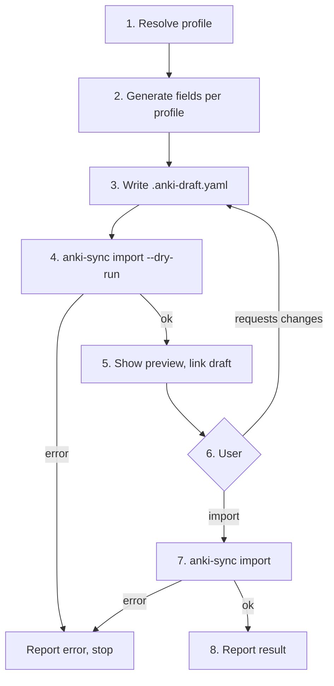

# Anki Vocabulary Sync Skill

Creates foreign-language flashcards through a **Draft-and-Review** workflow: draft cards into `.anki-draft.yaml`, validate, show the user, then import on explicit confirmation.

Before any `anki-sync` command, resolve the binary (see [references/cli.md](references/cli.md#locating-the-binary)):
1. `anki-sync` on PATH, if present.
2. Otherwise `<skill-dir>/bin/<platform>/anki-sync` (`anki-sync.exe` on Windows), where `<platform>` is `darwin-arm64` or `windows-amd64`.
3. If neither works, report that the binary is missing and stop. Do not build it or download anything.

Reference docs (load when needed):
- [references/cards.md](references/cards.md): field generation rules, pronunciation formats, examples per language.
- [references/cli.md](references/cli.md): `anki-sync` commands, draft format, error handling.

---

## 1. When to Activate

**Activate when the user:**
- Asks to add words or notes to Anki (e.g. _"Add たまご to my Japanese deck"_, _"Save flâner into Anki"_).
- Asks to create flashcards for words (e.g. _"Make flashcards for these 5 French verbs"_).
- Asks to import or sync pending draft cards (e.g. _"Import the cards"_, _"Sync to Anki"_).

**Do not activate for:**
- Translations or definitions with no request to save them (e.g. _"What does 'flâner' mean?"_).
- Grammar or conjugation help without a flashcard request.
- Conversation or writing practice.

---

## 2. Workflow

### Step 1: Resolve Profile
- Read the profile list with `anki-sync profiles`. Do not open profile files directly.
- Match the requested language to a profile key (e.g. `japanese`, `french`).
- If the match is ambiguous or missing, ask the user, listing the available profiles.

### Step 2: Generate Fields
- Generate only the keys in `profile.fields`. Never add fields from another language.
- Apply `profile.level`, `profile.pronunciation`, and `profile.rules`.
- Follow the rules in [references/cards.md](references/cards.md).

### Step 3: Write Draft
- Write `.anki-draft.yaml` using the format in [references/cli.md](references/cli.md).
- `profile` must match a profile key. `cards` must be a non-empty list.

### Step 4: Validate
- Run `anki-sync import --dry-run .anki-draft.yaml` before showing the preview.
- If it fails, fix only the invalid fields the error names. If you can't fix it, report the error and stop.

### Step 5: Preview
Show a short preview table in chat and link the draft:

> _"I've drafted the note(s) in [`.anki-draft.yaml`](.anki-draft.yaml). Edit any field or ask me to adjust sentences. When ready, say **import** to add them to Anki."_

### Step 6: Review
- If the user requests changes, edit `.anki-draft.yaml`, re-run the dry run (Step 4), and show the updated preview.
- Import only when the user explicitly says so (e.g. "import", "sync it"). Words like "ok" or "looks good" count only as a reply to a preview, not as a standalone instruction to import.

### Step 7: Import
Run `anki-sync import .anki-draft.yaml`.

### Step 8: Report
Report cards added, audio generated, and the target deck, using the CLI output.

---

## 3. Error Handling (Strict)

- **Use `anki-sync` as the only interface to Anki.** Never call AnkiConnect directly (no `curl` to `localhost:8765`, no raw JSON-RPC, no touching Anki's collection or media files).
- **On any `anki-sync` error, stop and report it verbatim.** Do not retry with other commands or workarounds.
- Retry only when the user asks, or after the user confirms the cause is fixed.
- Edit the draft to fix an import error only when the error names a specific invalid field. Tell the user what changed before re-running.
- If `anki-sync check` fails, tell the user to open Anki with the AnkiConnect add-on enabled, then stop.
- If the import reports duplicate notes, list them and ask the user what to do. Do not delete or overwrite existing notes.
