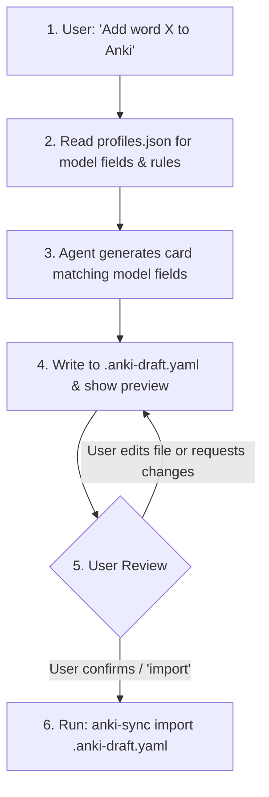

# Anki Vocabulary Sync Skill

This skill coordinates creating foreign language vocabulary flashcards in local Anki decks with automatic linguistic generation (IPA/readings, pitch accent, example sentences, translations) and audio synthesis.

It enforces a **Draft-and-Review** workflow: the agent generates cards into an editable draft file (`.anki-draft.yaml`), allows the user to inspect/edit it, and imports to Anki upon confirmation.

---

## 1. When to Activate (Strict Triggers)

### DO Activate When:

- User explicitly asks to add words to Anki (e.g., _"Add たまご to my Japanese deck"_, _"Save flâner into Anki"_).
- User asks to create/generate flashcards or notes for words (e.g., _"Make flashcards for these 5 French verbs"_).
- User asks to review or import pending draft cards into Anki (e.g., _"Import the cards"_, _"Sync to Anki"_).

### DO NOT Activate When:

- The user is only asking for a translation or definition (e.g., _"What does 'flâner' mean?"_).
- The user is asking for general grammar assistance or conjugation help without asking for flashcards.
- The user is practicing conversation or writing exercises.

---

## 2. Dynamic Profile & Card Model Architecture

**Always inspect `profiles.json` first.** It defines the deck, note model, pronunciation guide, and exact card fields for each language:

```json
{
  "deck": "Japanese::N5",
  "model": "JP_sheet",
  "target_lang": "ja",
  "translation_lang": "vn",
  "level": "N5-N4",
  "pronunciation": "Standard Kana with Tokyo pitch accent type in brackets [0], [1]...",
  "rules": "...",
  "fields": { ... },
  "audio": { ... }
}
```

### Key Principles:

1. **Model-Specific Fields (No Useless Fields)**:
   - Each language model in Anki has different fields.
   - For example, Japanese has a `Kanji` field, while French does **not**. French has gender articles and IPA.
   - **Rule**: Only generate the keys defined in `profile.fields`. Never invent fields or carry over irrelevant fields (e.g. no `Kanji` in French).
2. **Pronunciation Guides**:
   - **French**: Always generate **International Phonetic Alphabet (IPA)** enclosed in slashes (e.g. `/livʁ/`, `/flɑ.ne/`).
   - **Japanese**: Generate Kana with Tokyo pitch accent type in brackets (e.g. `だいがく [0]`, `たまご [2]`), strictly obeying the mora count constraint.
   - **Mandarin (if configured)**: Generate standard Pinyin with tone marks.
3. **Sentence Convention**:
   - Target sentence field: `Sentence_<TARGET_LANG>` (e.g., `Sentence_JP`, `Sentence_FR`).
   - Translation sentence field: `Sentence_<TRANSLATION_LANG>` (e.g., `Sentence_VN`).
4. **Audio Mapping**:
   - Defined under `profile.audio` mapping: `"<AnkiAudioField>": "<SourceTextField>"`.
   - e.g. `"Audio": "Expression"`, `"SentenceAudio": "Sentence_FR"`.

---

## 3. The 4-Step Workflow



### Step 1: Resolve Profile

Match the requested language/deck to a profile in `profiles.json` (e.g. `japanese`, `french`). If ambiguous, ask the user or list available profiles.

### Step 2: Generate Card Fields

Strictly populate the fields specified in `profile.fields`, applying `profile.level`, `profile.pronunciation`, and `profile.rules`.

#### Japanese Example:

- `Expression`: `たまご`
- `Reading`: `たまご [2]` _(Tokyo pitch accent)_
- `Meaning`: `trứng`
- `Kanji`: `卵`
- `Type`: `Noun`
- `Sentence_JP`: `あさごはんに たまごを たべます。` _(N5-N4 level, simple kanji)_
- `Sentence_VN`: `Tôi ăn trứng vào bữa sáng.`

#### French Example:

- `Expression`: `le livre` _(includes article for nouns)_
- `Reading`: `/livʁ/` _(IPA)_
- `Meaning`: `cuốn sách`
- `Type`: `Nom (m)`
- `Sentence_FR`: `Je lis un livre intéressant ce soir.` _(A0-A1 level)_
- `Sentence_VN`: `Tối nay tôi đọc một cuốn sách thú vị.`
  _(Notice: No Kanji or non-existent fields!)_

---

### Step 3: Write Draft (`.anki-draft.yaml`)

Write the structured cards into `.anki-draft.yaml`:

```yaml
profile: french
cards:
  - Expression: le livre
    Reading: /livʁ/
    Meaning: cuốn sách
    Type: Nom (m)
    Sentence_FR: Je lis un livre intéressant ce soir.
    Sentence_VN: Tối nay tôi đọc một cuốn sách thú vị.
```

Present a preview table in chat and link to [`.anki-draft.yaml`](file:///.anki-draft.yaml):

> _"I've drafted the note(s) in [`.anki-draft.yaml`](file:///.anki-draft.yaml). Feel free to tweak any field in your editor or ask me to adjust sentences. When ready, say **import** to add to Anki."_

---

### Step 4: Review & Import

1. **If user wants changes**:
   Edit `.anki-draft.yaml` directly using file editing tools and confirm with the user.
2. **If user confirms** (_"looks good"_, _"import"_, _"ok"_):
   Run the import command:
   ```bash
   anki-sync import .anki-draft.yaml
   ```
3. Report the result (cards added, audio generated, target deck).

---

## 4. CLI Helper Reference

- `anki-sync check`: Verify AnkiConnect is running (`http://localhost:8765`).
- `anki-sync profiles`: List all configured profiles from `profiles.json`.
- `anki-sync import <draft.yaml>`: Import draft into Anki with auto-generated TTS audio.
- `anki-sync import --dry-run <draft.yaml>`: Validate draft and preview payload without writing to Anki.
