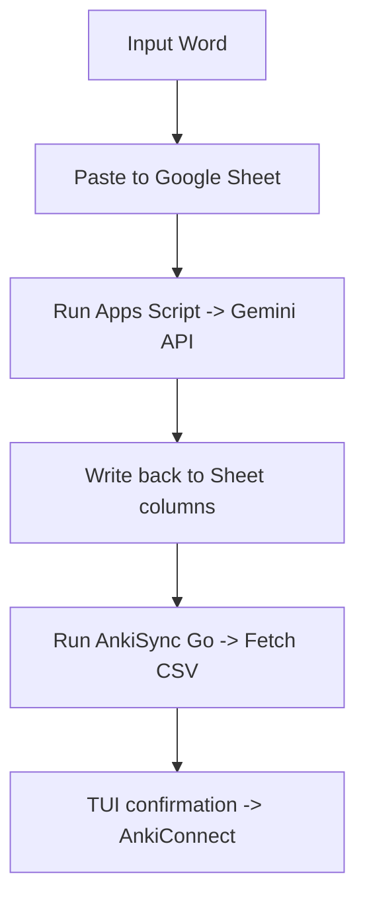
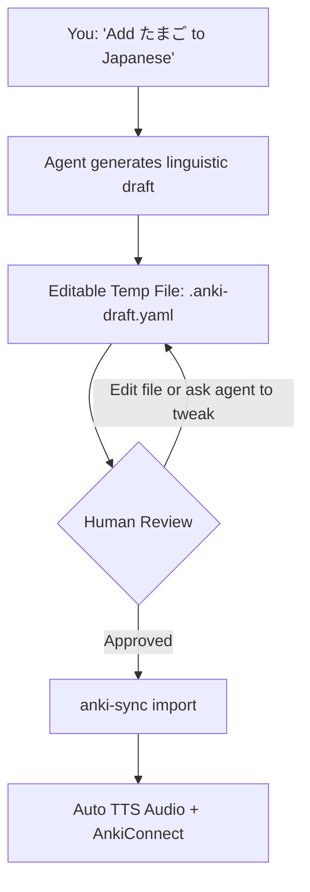

# AnkiSync Go Refactoring Plan (Agentic & Draft-Review Architecture)

## 1. Vision & Core Paradigm Shift

We are replacing the clunky **Google Sheets + Google Apps Script + AnkiSync** pipeline with a unified, **Agent-First workflow**.

### Old Pipeline vs New Workflow

Old



New



---

## 2. Key Requirements

1. **No More Google Sheets or Apps Script**: No CSV parsing, GIDs, or Google API keys in script properties.
2. **Agent Generates Linguistic Data**: The agent (AGY, Claude Code, Cursor) uses the proven prompt rules from `Code.js` (N5 grammar, Tokyo pitch accents `[0]`, simple kanji, Vietnamese translations; French grammar/gender).
3. **Human-in-the-Loop Review Step**:
   - The agent writes newly generated cards into an editable draft file (e.g., `.anki-draft.yaml`).
   - The user can review and edit this file in their editor, or instruct the agent to tweak sentences.
4. **Lean Go Importer Engine**:
   - The Go tool reads `.anki-draft.yaml`.
   - Generates Google TTS audio for configured fields using the profile language code (`ja`, `fr`).
   - Pushes cards directly to Anki via AnkiConnect (`localhost:8765`).
   - Deletes or clears the draft file on successful import.
5. **No Backup Ledger Needed**: Anki is the single source of truth.

---

## 3. Configuration Design (`config.json`)

Clean, minimal multi-profile configuration without any sheet URLs or CSV column mappings:

```json
{
  "profiles": {
    "japanese": {
      "deck": "Japanese::N5",
      "model": "JP_sheet",
      "tts_lang": "ja",
      "audio_fields": {
        "Expression": "Audio",
        "Sentence_JP": "SentenceAudio"
      }
    },
    "french": {
      "deck": "French::A1",
      "model": "French_sheet",
      "tts_lang": "fr",
      "audio_fields": {
        "Expression": "Audio",
        "Sentence_FR": "SentenceAudio"
      }
    }
  }
}
```

---

## 4. The Draft File Format (`.anki-draft.yaml`)

A human-friendly YAML format that is easy to read, edit, and validate:

```yaml
profile: japanese
cards:
  - Expression: たまご
    Reading: たまご [2]
    Meaning: trứng
    Kanji: 卵
    Type: Noun
    Sentence_JP: あさごはんに たまごを たべます。
    Sentence_VN: Tôi ăn trứng vào bữa sáng.

  - Expression: べんきょうする
    Reading: べんきょうする [0]
    Meaning: học tập
    Kanji: 勉強する
    Type: Verb-irr
    Sentence_JP: まいにち にほんごを べんきょうします。
    Sentence_VN: Tôi học tiếng Nhật mỗi ngày.
```

---

## 5. Go Codebase Architecture

Consolidate the codebase into 2 core packages:

```
anki-sync-go/
  cmd/
    anki-sync/
      main.go               # CLI subcommands: import, check, profiles
  internal/
    anki/
      client.go             # AnkiConnect HTTP client (AddNotes, GetNotes, StoreMedia)
      models.go             # Anki payload structs
    importer/
      config.go             # Profile loader & validation
      draft.go              # YAML draft parser & validator
      tts.go                # Google TTS audio generator (lang, md5 hash)
      importer.go           # Pipeline: draft -> TTS -> AnkiConnect
  skills/
    anki-sync/
      SKILL.md              # Instructions for AGY, Claude Code, Cursor
  config.json               # Profiles (Japanese, French, etc.)
  .anki-draft.yaml          # Staged draft (gitignored)
```

### Removed Packages

- `internal/sheet` $\rightarrow$ Completely deleted.
- `internal/status`, `internal/syncer`, `internal/executor`, `internal/plan` $\rightarrow$ Consolidated into `internal/importer`.
- `internal/ui` $\rightarrow$ Replaced with clean CLI output (`anki-sync import .anki-draft.yaml`).

---

## 6. Agent Skill Definition (`skills/anki-sync/SKILL.md`)

The skill instructs AGY / Claude Code how to interact with the user, generate vocabulary following strict linguistic guidelines, manage the draft file, and trigger the import:

### Workflow for the Agent:

1. **User asks to add words**: e.g. _"Add French word: flâner"_.
2. **Agent generates draft**:
   - Applies language rules (N5 grammar, Tokyo pitch accent brackets, Vietnamese translation, or French gender/verb types).
   - Writes cards into `.anki-draft.yaml`.
   - Displays a preview summary table to the user in chat.
3. **Review & Iterate**:
   - User can edit `.anki-draft.yaml` directly in their IDE.
   - User can ask the agent: _"Change the sentence for word X"_. The agent modifies `.anki-draft.yaml`.
4. **Import**:
   - When approved (_"looks good, import"_, or `import`), the agent runs:
     ```bash
     go run ./cmd/anki-sync import .anki-draft.yaml
     ```
   - On success, reports the cards added and audio generated.

---

## 7. Implementation Roadmap

- [ ] **Step 1: Simplify `config.json`**: Update config to multi-profile format (Japanese & French) without sheet fields.
- [ ] **Step 2: Add YAML Draft Parser & Importer**:
  - Add `gopkg.in/yaml.v3` dependency.
  - Implement `internal/importer` to parse draft, generate TTS, and add cards to AnkiConnect.
- [ ] **Step 3: Clean up Go codebase**: Remove `sheet`, `syncer`, `executor`, `plan`, `status`, and `ui` packages.
- [ ] **Step 4: Create CLI subcommands**:
  - `anki-sync import [file]`
  - `anki-sync check [profile]`
  - `anki-sync profiles`
- [ ] **Step 5: Author `skills/anki-sync/SKILL.md`**: Embed the linguistic generation prompts from `Code.js` and CLI runbooks for AGY and Claude Code.
- [ ] **Step 6: End-to-End Test**: Test drafting a Japanese card, reviewing/editing it, and importing it into Anki via AnkiConnect.
